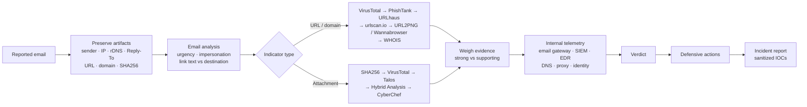

# Report Writing Using Phishing Tools


A hands-on **phishing investigation and report-writing lab**. It shows how a SOC analyst takes a reported email, runs its indicators through ten public analysis tools (VirusTotal, urlscan.io, URLhaus, PhishTank, Cisco Talos, Hybrid Analysis, URL2PNG, Wannabrowser, WHOIS and CyberChef), weighs the evidence, and turns it into a **clear, defensible incident report**.

The repository contains a step-by-step investigation workflow, a tool reference, evidence-writing guidelines, a reusable 17-section report template, a findings-language cheat sheet, and a **complete sample report** for a credential-phishing case.

> **Sample case at a glance:** an email posing as an Outlook security alert ("Your Email Will be Locked! Act NOW!") was sent from Gmail infrastructure to five recipients and linked to a fake Outlook login page on `emailsecalerts[.]net`. Verdict: **Credential Phishing, Medium severity**, with **no user interaction** found in the reviewed email gateway, SIEM and EDR telemetry.

## Why I Did This

Running a URL through VirusTotal takes seconds. Writing a report that a manager can act on, and that still holds up when someone asks *"how do you know?"*, is the harder skill. Most phishing write-ups I saw either dumped tool output or jumped straight to "this is malicious". I wanted to practise the full analyst loop: collect artifacts without touching live infrastructure, check them against several independent sources, separate strong evidence from supporting evidence, avoid overclaiming what any single tool proves, and finish with recommendations tied to the evidence.

## Highlights

- **End-to-end workflow:** eight phases from preserving the email to writing the report, with a recommended tool order for URLs and for attachments.
- **Ten-tool coverage:** what each tool is good for, what evidence to capture from it, and what it *cannot* prove.
- **Evidence-strength model:** sandbox behaviour, urlscan.io renders, Talos verdicts and multi-vendor detections treated as strong evidence; PhishTank/URLhaus listings, domain age, remote screenshots and decoded values treated as supporting evidence.
- **Overclaim-proof wording:** side-by-side "don't say / say instead" examples for VirusTotal, WHOIS and screenshot findings.
- **Indicator sanitization:** every URL, domain and IP defanged (`hxxps://`, `[.]`) so nothing in the repo is clickable.
- **Reusable report template:** 17 sections from executive summary to evidence index, limitations and conclusion.
- **Findings-language cheat sheet:** ready-to-adapt sentences for reputation, webpage, WHOIS, sandbox, CyberChef and telemetry findings.
- **Complete sample report:** a credential-phishing case written in full, including IOCs, defensive measures and stated limitations.

## Sample Case Findings

From [`sample-report/sample-phishing-report.md`](sample-report/sample-phishing-report.md):

| # | Finding | Evidence |
|---|---|---|
| 1 | **Brand impersonation** | Email used Outlook branding and account-lock urgency, but reverse DNS of the sending IP `209.85.222.173` resolved to Gmail (`mail-qk1-f173.google.com`). |
| 2 | **Credential-harvesting page** | Remote webpage analysis showed an Outlook-style form asking for email address and password. |
| 3 | **Malicious reputation** | VirusTotal showed malicious and phishing vendor classifications for the domain at the time of analysis. |
| 4 | **No confirmed user interaction** | Email gateway showed no replies to the sender; SIEM and EDR showed no connections to the domain during the reviewed period. |

**Indicators of compromise (sanitized):**

```text
Sender:            emailsecalert1@gmail.com
Sending Server IP: 209.85.222.173
Root Domain:       emailsecalerts[.]net
URL:               hxxps://outlook-security.emailsecalerts[.]net/index/2020/OWA.php
```

**Actions recommended:** block the sender and root domain, search for and remove other copies of the message, keep monitoring for connections to the domain, add the indicators to detection workflows, and reset credentials and revoke sessions if later evidence shows a submission.

## Tools & Technologies

| Tool | Used for | Caution recorded |
|---|---|---|
| **VirusTotal** | Multi-engine reputation for URLs, domains, IPs, hashes and files | A clean result does not prove an artifact is safe |
| **urlscan.io** | Safe page render, screenshot, redirect chain, requests, contacted infrastructure | Shows behaviour at scan time only |
| **URLhaus** | Malware-delivery URL intelligence | Absence does not prove a URL is benign |
| **PhishTank** | Phishing-specific URL reputation | Supporting, not conclusive |
| **Cisco Talos File Reputation** | SHA256 file reputation and classification | Don't rely on a score alone |
| **Hybrid Analysis** | Sandbox behaviour: processes, dropped files, DNS, network | Only with authorization |
| **URL2PNG** | Remote screenshot of a suspicious page | Shows appearance, not full behaviour |
| **Wannabrowser** | HTML and user-agent comparison, cloaking checks | Inspect without normal browsing |
| **WHOIS / ICANN Lookup** | Registration date, registrar, name servers | Domain age alone is not proof |
| **CyberChef** | Decoding, deobfuscation, hashing, header cleanup | Record input and output |

Full details in the [Tool Reference](docs/tool-reference.md).

## Investigation Flow



## Investigation Workflow

1. **Preserve evidence:** record sender, subject, recipients, sending IP, reverse DNS, Reply-To, date, URL, root domain and attachment hash without altering the original.
2. **Analyze the email:** display name vs real address, urgency, threats, credential or payment requests, brand impersonation, link text vs actual destination.
3. **Analyze URLs:** passive sources first, then safe rendering, then registration data.
4. **Analyze attachments:** hash, reputation, then sandbox only if authorized; never run them locally.
5. **Check internal telemetry:** did anyone receive, reply, click, resolve the domain, submit credentials or download a payload?
6. **Reach a verdict:** from benign through credential phishing, malware delivery or BEC to "insufficient evidence", based on several independent observations.
7. **Recommend actions:** each one tied to a specific piece of evidence.
8. **Write the report:** what happened, what was collected, what each tool showed, the assessment, user interaction, and next steps.

Full checklist in [Investigation Workflow](docs/investigation-workflow.md).

## Evidence Strength & Reporting Rules

| Strong evidence | Supporting evidence |
|---|---|
| Hybrid Analysis behavioural observations | PhishTank listing |
| urlscan.io page render and redirect chain | URLhaus listing |
| Talos malicious reputation on a SHA256 | Recently registered domain |
| Multiple independent VirusTotal detections | Remote screenshot |
| | CyberChef-decoded destination |

No single signal decides the verdict. The wording rules in this repo follow from that:

| ❌ Don't say | ✅ Say instead |
|---|---|
| "VirusTotal has zero detections, so the URL is safe." | "VirusTotal showed no detections at the time of analysis. This does not prove the URL is benign, so additional evidence was reviewed." |
| "The domain is malicious because it is new." | "WHOIS shows a recent registration. This is a supporting indicator, consistent with short-lived phishing infrastructure when considered with the other findings." |
| "The screenshot proves the site steals passwords." | "The screenshot shows a credential form imitating the brand. Behavioural or network evidence is needed to show how submitted data is handled." |

See [Evidence Guidelines](docs/evidence-guidelines.md) and the [Findings Language Cheat Sheet](templates/findings-language-cheatsheet.md).

## Repository Structure

```text
report-writing-using-phishing-tools/
├── README.md
├── DISCLAIMER.md
├── LICENSE
├── docs/
│   ├── investigation-workflow.md        # 8-phase investigation checklist
│   ├── tool-reference.md                # what each tool shows and its limits
│   ├── evidence-guidelines.md           # observation vs interpretation, avoiding overclaims
│   └── screenshot-guide.md              # naming, captions and redaction rules
├── templates/
│   ├── phishing-investigation-template.md   # 17-section report template
│   └── findings-language-cheatsheet.md      # reusable finding sentences
├── sample-report/
│   └── sample-phishing-report.md        # full credential-phishing case report
├── screenshots/                         # evidence screenshots (numbered)
└── assets/                              # diagrams and non-evidence graphics
```

## Project Documentation

1. [Investigation Workflow](docs/investigation-workflow.md): the eight phases, from preserving evidence to writing the report.
2. [Tool Reference](docs/tool-reference.md): what to capture from each of the ten tools and what each cannot prove.
3. [Evidence Guidelines](docs/evidence-guidelines.md): making a point then backing it, timestamps, reproducibility and avoiding overclaims.
4. [Screenshot Guide](docs/screenshot-guide.md): naming convention, what each screenshot should show, what to redact.
5. [Report Template](templates/phishing-investigation-template.md): a blank 17-section phishing investigation report.
6. [Findings Language Cheat Sheet](templates/findings-language-cheatsheet.md): wording for each type of finding.
7. [Sample Report](sample-report/sample-phishing-report.md): the completed credential-phishing case.
8. [Disclaimer](DISCLAIMER.md): safe-handling rules for live indicators and confidential data.

## How to Review

1. **Read the sample report first:** [sample-phishing-report.md](sample-report/sample-phishing-report.md) shows the finished product: executive summary, artifacts, analysis, findings, assessment, actions, IOCs and limitations.
2. **Check the method:** follow [investigation-workflow.md](docs/investigation-workflow.md) to see how each section of the report was produced.
3. **Check the reasoning:** compare the report's wording with [evidence-guidelines.md](docs/evidence-guidelines.md); every conclusion is tied to evidence and nothing is overclaimed.
4. **Reuse it:** copy the [template](templates/phishing-investigation-template.md) and [cheat sheet](templates/findings-language-cheatsheet.md) for your own investigation.

## Skills Demonstrated

- **Phishing triage:** reading sender, Reply-To, reverse DNS and content for impersonation and social-engineering cues.
- **IOC analysis:** URL, domain, IP and file-hash reputation across multiple independent sources.
- **Web and infrastructure analysis:** safe rendering, redirect chains, cloaking checks and WHOIS registration data.
- **Malware triage:** hash reputation and sandbox behavioural analysis workflow.
- **Artifact decoding:** CyberChef for Base64, URL encoding, hex and obfuscated strings.
- **Evidence handling:** preservation, timestamps, reproducibility and indicator sanitization.
- **Analytical judgement:** strong vs supporting evidence, observation vs interpretation, no single-tool verdicts.
- **Incident response:** telemetry-driven scoping (gateway, SIEM, EDR) and evidence-based containment actions.
- **Technical writing:** structured SOC incident reports, findings language and a reusable template.

## Roadmap

- Add sanitized evidence screenshots for each phase of the sample case (VirusTotal, urlscan.io, WHOIS, gateway, SIEM, EDR)
- Add an email-header analysis walkthrough (SPF, DKIM, DMARC, Received chain)
- Add a second worked case covering a malicious attachment with Hybrid Analysis
- Map sample-case activity to MITRE ATT&CK (T1566 Phishing)
- Export the sample report as a PDF

---

## Disclaimer

This repository is for defensive cybersecurity education, portfolio demonstration and authorized analysis only. The sample case uses sanitized training data. Do not visit live malicious URLs or run suspicious files on personal or production systems, and never submit confidential organizational data to public analysis services without permission. See [DISCLAIMER.md](DISCLAIMER.md).

---

## Author

**Anik Nohan**

This project was built to practise and demonstrate real-world SOC analyst skills in:

- Phishing email triage and investigation
- IOC, URL, domain and file reputation analysis
- Passive threat-intelligence research
- Sandbox and webpage behaviour analysis
- Evidence-strength assessment and multi-source correlation
- Indicator sanitization and evidence preservation
- Phishing incident report writing and defensive recommendations

Also see my **[Windows DFIR Security Event Investigation](https://github.com/aniknohan/windows-dfir-security-event-investigation)** and **[CyberHire AI Cybersecurity Interview Simulator](https://github.com/aniknohan/cyberhire-windows-ai-lab)**.

### Tools Used

`VirusTotal` • `urlscan.io` • `URLhaus` • `PhishTank` • `Cisco Talos` • `Hybrid Analysis` • `URL2PNG` • `Wannabrowser` • `WHOIS / ICANN Lookup` • `CyberChef` • `GitHub`

## License

Released under the [MIT License](LICENSE).
